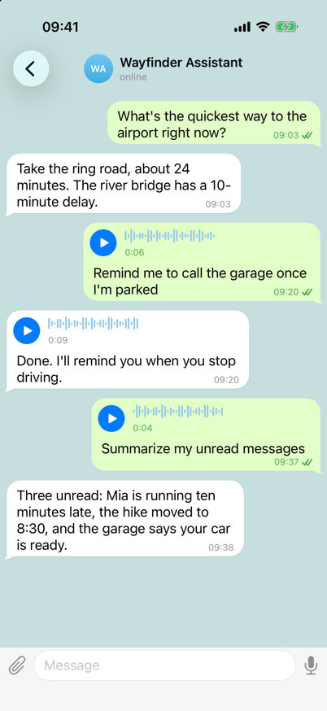
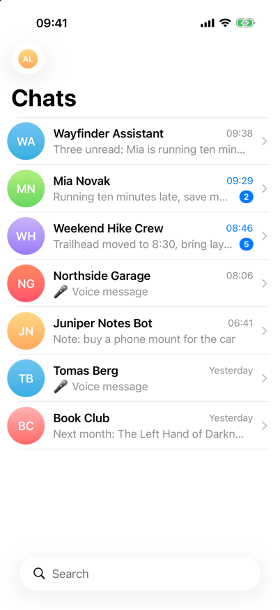
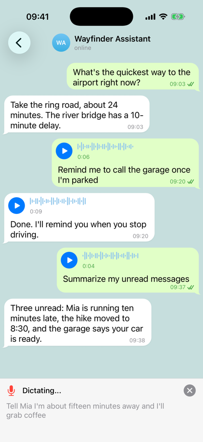
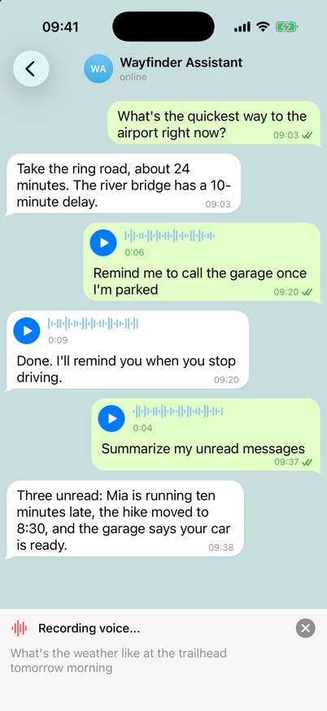
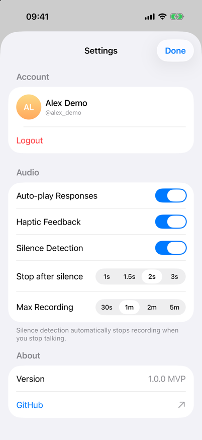

<p align="center">
  
</p>

<h1 align="center">Telegrowl</h1>

<p align="center">
  <b>A hands-free Telegram voice client for iOS, built for talking to AI bots while you drive.</b>
</p>

<p align="center">
  
  
  
  
  <a href="LICENSE"></a>
</p>

<p align="center">
  
</p>

## How it works

1. Open a chat, typically with an AI assistant bot. Speech recognition runs
   continuously while the chat is open.
2. Start a command with a trigger word ("text message" and "voice message"
   also work):
   - **"text …"** transcribes your speech and sends it as a text message.
   - **"voice …"** records a voice message and sends it with the transcript
     as the caption.
3. The command ends after 3 seconds without new recognized words. Speech
   that doesn't start with a trigger word is ignored.
4. Incoming voice messages play automatically. Replies that arrive during a
   command are played after it finishes.

Outgoing messages go through an on-disk queue and are retried when the
connection comes back.

> **Status:** personal project, not on the App Store. It works end to end
> against real Telegram accounts, but it has only been tested on a handful of
> devices. See [Disclaimer](#disclaimer).

## Features

- **Real Telegram voice messages**: OGG/Opus with a proper waveform, trimmed
  to half a second after your last word.
- **Works with car audio**: Bluetooth hands-free and A2DP.
- **A regular Telegram UI for when you're parked**: chat list, search
  (including `@username`), message bubbles, and a text field.

## Things that broke along the way

Getting speech-driven messaging to behave in a moving car took more than the
happy path. Some of the problems, from the commit history:

- **Road noise is not silence.** Ending commands on microphone level (dB)
  failed in the car, because level-based detection treats engine, wind, and
  bump noise as speech. A command now ends when the *speech recognizer* has
  produced no new words for 3 seconds, and the recording is trimmed to 0.5 s
  after the last recognized word.
- **Trigger words fired about 10% of the time.** Two bugs compounded.
  Recognition silently stopped after each pause (the final result was never handled),
  and cancelling a task to restart it triggered an error callback that killed
  the replacement. The fix restarts on final results, ignores self-inflicted
  cancellation errors, and debounces restarts. A rolling restart every 50 s
  stays under Apple's ~60 s recognition limit, and a health check revives a
  stalled recognizer.
- **Bluetooth crashed the app.** Car hands-free profiles run the microphone at
  24 kHz while the audio engine reported 48 kHz, so installing the input tap
  failed. The tap now uses the hardware input format.
- **TDLib never connected on real devices.** On iOS it doesn't detect network
  changes itself, so the app relays `NWPathMonitor` updates with
  `setNetworkType`.
- **Voice messages looked wrong in other clients.** Telegram stores waveforms
  as bit-packed 5-bit samples; sending one value per byte rendered as noise.
- **Uploads failed for longer recordings.** TDLib uploads asynchronously after
  `sendMessage` returns, so the OGG file must outlive the call. TDLib also
  needs symlink-free file paths.

## Screenshots

| Chats | Dictating a text | Recording a voice message | Settings |
|:---:|:---:|:---:|:---:|
|  |  |  |  |

All screenshots use fictional data from [Demo Mode](#demo-mode) and are
reproducible with `scripts/screenshots/capture.sh`.

## Quick start

**Requirements:** macOS with Xcode 16 or later, [XcodeGen](https://github.com/yonaskolb/XcodeGen)
(`brew install xcodegen`), an iOS 17+ device or simulator, and Telegram API
credentials. Dictation and voice recording need a real device with a
microphone; the simulator is fine for the UI.

```bash
git clone https://github.com/vs/telegrowl.git
cd telegrowl

# 1. Telegram API credentials (get them at https://my.telegram.org/apps)
cp Telegrowl/App/Config.swift.template Telegrowl/App/Config.swift
#    then set telegramApiId and telegramApiHash in Config.swift

# 2. Code signing (only needed for real devices)
cp Configs/Signing.local.xcconfig.template Configs/Signing.local.xcconfig
#    then set DEVELOPMENT_TEAM to your Apple Team ID

# 3. Generate the Xcode project and open it
xcodegen generate
open Telegrowl.xcodeproj
```

Select the **Telegrowl** scheme and run (⌘R). Swift Package Manager fetches
TDLibKit and SwiftOGG on the first build. Both `Config.swift` and
`Signing.local.xcconfig` are gitignored.

More detail, including troubleshooting, is in [docs/setup.md](docs/setup.md).

### Demo Mode

Debug builds can run without TDLib or a Telegram account:

```bash
xcrun simctl launch booted com.telegrowl.Telegrowl -demo
```

With `-demo` the welcome screen shows a **Demo Mode** button. Set
`TELEGROWL_DEMO_FIXTURES` to a JSON file (for example
[`scripts/screenshots/fixtures/demo.json`](scripts/screenshots/fixtures/demo.json))
to populate chats and messages; the other `TELEGROWL_DEMO_*` switches are
documented in [`DemoFixtures.swift`](Telegrowl/Services/DemoFixtures.swift).
Demo Mode never starts TDLib, so it makes no network requests.

## Configuration

There are no environment variables. Credentials are compile-time constants in
the gitignored `Config.swift`; user preferences are stored in `UserDefaults`
with defaults registered at launch.

| Setting | Where | Default | Used by |
|---|---|---|---|
| `telegramApiId` | `Config.swift` (required) | `0` | TDLib parameters |
| `telegramApiHash` | `Config.swift` (required) | `""` | TDLib parameters |
| `tdlibDatabasePath` | `Config.swift` | `Documents/tdlib` | TDLib database |
| `tdlibFilesPath` | `Config.swift` | `Documents/tdlib_files` | TDLib downloads |
| `DEVELOPMENT_TEAM` | `Configs/Signing.local.xcconfig` | empty | Code signing |
| Auto-play Responses | Settings screen | on | Auto-play of incoming voice |
| Haptic Feedback | Settings screen | on | Recording and dictation haptics |
| Silence Detection | Settings screen | on | Auto-stop for **manual** recordings |
| Stop after silence | Settings screen | 2 s | Manual recordings |
| Max Recording | Settings screen | 1 min | Manual recordings |
| `silenceThreshold` | `UserDefaults` only | −45 dB | Manual-recording silence level |
| `speechLocale` | `UserDefaults` only | `en-US` | Speech recognizer locale |
| `dictationSilenceTimeout` | `UserDefaults` only | 3 s | End of a dictated command |

Settings marked "`UserDefaults` only" have no UI yet; change their defaults in
`Config.registerDefaults()`.

## Architecture

```
TelegrowlApp
└── ContentView                 navigation, toasts, connection banner
    ├── AuthView                phone → code → 2FA
    ├── ChatListView            chats, search, settings
    └── ConversationDestination one per open chat
        ├── ConversationView    message bubbles, waveforms, playback
        ├── InputBarView        text field, mic, dictation overlay
        └── DictationService    trigger words, speech-to-text, recording

Singleton services (@MainActor)
├── TelegramService    TDLib client, auth state machine, chats, messages, files
├── AudioService       manual recording, playback, silence detection, haptics
├── AudioConverter     M4A → OGG/Opus, waveform generation
└── MessageSendQueue   persistent FIFO queue for text and voice messages
```

Every outgoing message, typed or dictated, text or voice, goes through
`MessageSendQueue`, which is persisted to `Documents/send_queue/queue.json`.
A failed send is retried with TDLib's `resendMessages` when possible, and
otherwise re-sent with exponential backoff. The queue pauses while offline.

`DictationService` runs one `AVAudioEngine` input tap that feeds both
`SFSpeechRecognizer` and, while recording, an `AVAudioFile`. In `idle` it only
looks for trigger words; after `text` or `voice` it captures until the
recognizer has produced nothing new for the silence timeout.

[CLAUDE.md](CLAUDE.md) has a more detailed walkthrough of the data flow and
implementation notes.

## Development

- **Leak guard:** run `./scripts/setup-hooks.sh` once after cloning. Git hooks
  and CI scan every commit for secrets and personal data; see
  [CONTRIBUTING.md](CONTRIBUTING.md#leak-guard).
- **Project file:** `Telegrowl.xcodeproj` is generated from
  [`project.yml`](project.yml). Run `xcodegen generate` after adding or removing
  files and commit the regenerated project.
- **Build from the command line:**
  ```bash
  xcodebuild -scheme Telegrowl \
    -destination 'platform=iOS Simulator,name=iPhone 17 Pro' build
  ```
  `swift build` does not work because the app uses iOS-only frameworks;
  `Package.swift` exists only to resolve dependencies.
- **Tests:** there is no automated test suite yet. Changes are verified by
  building and by running on a device.
- **Screenshots:** `scripts/screenshots/capture.sh` builds the app, launches it
  in Demo Mode on a simulator with a fixed status bar, and writes
  `docs/screenshots/*.png`.
- **Logging:** `print()` with emoji prefixes: 📱 Telegram, 🎙️ Audio,
  🔄 Conversion, 📤 Send, 📥 Download, 🗣️ Speech, ❌ Error.

## Documentation

| Document | Contents |
|---|---|
| [docs/setup.md](docs/setup.md) | Detailed setup, signing, and troubleshooting |
| [CLAUDE.md](CLAUDE.md) | Architecture and implementation notes (also used by AI coding agents) |
| [CONTRIBUTING.md](CONTRIBUTING.md) | How to contribute, conventions, and the leak guard |
| [SECURITY.md](SECURITY.md) | Reporting vulnerabilities and the security model |
| [docs/plans/](docs/plans/) | Historical design docs for the voice chat and voice control modes, which were later replaced by trigger-word dictation |

## Contributing

Issues and pull requests are welcome. Please read
[CONTRIBUTING.md](CONTRIBUTING.md) first; in particular, never commit your
`Config.swift`, Team ID, or anything from a real Telegram account.

## Disclaimer

- **Driving safety comes first.** Telegrowl is designed to reduce screen
  interaction, not to make it safe to use a phone while driving. Obey local
  laws, and don't look at or touch the screen while the vehicle is moving.
- **Unofficial client.** Telegrowl is an independent project, not affiliated
  with or endorsed by Telegram. It uses the official
  [TDLib](https://core.telegram.org/tdlib) library, and you must use your own
  API credentials in line with the
  [Telegram API Terms of Service](https://core.telegram.org/api/terms).
- **Your account, your data.** The app signs in to your real Telegram account
  and stores its session and caches on your device. Speech recognition may use
  Apple's servers when on-device recognition isn't available.
- Provided "as is", without warranty of any kind; see the license.

## License

Licensed under the [Apache License, Version 2.0](LICENSE). See [NOTICE](NOTICE)
for attributions.
